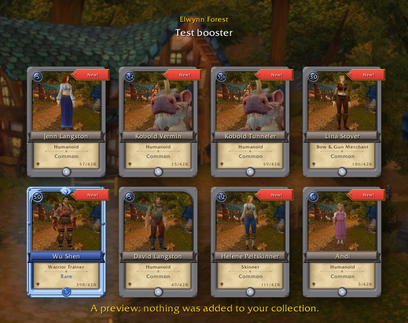

# Curator OctoWoW

**Préversion v0.5.1-alpha.3** — [ZIP complet](https://github.com/Toracles/Curator-OctoWoW/releases/download/v0.5.1-alpha.3/Curator-OctoWoW-v0.5.1-alpha.3.zip). Navigation d’inventaire optimisée, préparation progressive de l’interface et correctifs des menus Vanilla. Mesures simulées ; validation en jeu restante.

[English](README.md) · **Français**

Portage de Curator 1.14.3 adapté par CloudNine_Ex à **OctoWoW 1.18.1 sur le client WoW 1.12.1**. Collectionne les cartes de créatures, complète les albums, ouvre des boosters et des caisses, et échange avec d’autres joueurs. La collection est sauvegardée localement. [Périmètre de la licence](LICENSE-SCOPE.md#français)

[Télécharger Curator OctoWoW v0.5.0](https://github.com/Toracles/Curator-OctoWoW/releases/download/v0.5.0/Curator-OctoWoW-v0.5.0.zip)



*Aperçu d’un booster de la forêt d’Elwynn, capturé dans OctoWoW.* [Capture complète](docs/curator-octowow-booster.webp)

## Prérequis

| Fonction | Prérequis |
| --- | --- |
| Addon de base | OctoWoW sur le client WoW 1.12.1 et le ZIP complet de la version. Le fichier TOC ne déclare aucun addon obligatoire. |
| Modèles 3D disponibles et rattrapage de l’exploration | Charge `ClassicAPI.dll` via le launcher OctoWoW. L’installation de référence utilise **ClassicAPI 1.20.6**. Pour l’installer manuellement, place la DLL à côté de `WoW.exe`, ajoute-la à `dlls.txt` et démarre via VanillaFixes. [ClassicAPI](https://github.com/brues-code/ClassicAPI#installation) · [Modernization Tool d’OctoWoW](https://octowow.st/git/Dusk/Modernization-Tool/src/branch/main/README.md) |
| Rattrapage des quêtes | Historique des quêtes rendues confirmé par le client ou [Questie-Octo](https://github.com/SandreaSub/Questie-Octo). |
| Échanges en direct | Curator OctoWoW **alpha.23 ou plus récent** chez les deux joueurs. |
| Voix Mythic facultatives | **SoftSpoken** avec l’API publique v1 (l’installation de référence utilise **0.8.1-beta**) et le pack de voix bilingue séparé. |
| Galerie facultative | Le ZIP séparé de la galerie française et anglaise. |

Hoard est facultatif et sert à importer une ancienne sauvegarde. DXVK, les packs HD, SuperWoW et Nampower sont des options distinctes du client. Les ZIP s’installent directement dans le jeu. Node.js, Python, Lua, Piper et FFmpeg servent à la maintenance, aux tests ou à la génération des fichiers.

## Installer ou mettre à jour

1. Quitte OctoWoW et extrais le [ZIP complet v0.5.0](https://github.com/Toracles/Curator-OctoWoW/releases/download/v0.5.0/Curator-OctoWoW-v0.5.0.zip) dans `Interface/AddOns`. Il contient l’addon, les illustrations, les sons et tous les correctifs.
2. Pour une mise à jour, remplace le dossier `Interface/AddOns/Curator` existant par celui du ZIP. Garde tes sauvegardes de compte et de personnage dans `WTF`.
3. Vérifie que le fichier `Interface/AddOns/Curator/Curator.toc` est présent, puis lance OctoWoW. Active **Curator** à la sélection des personnages et tape `/curator`. Choisis le français ou l’anglais dans `/curator options`.

Pour installer la galerie bilingue facultative, extrais le [ZIP de la galerie](https://github.com/Toracles/Curator-OctoWoW/releases/download/v0.5.0/Curator-OctoWoW-Galerie-FR-EN.zip) dans `Interface/AddOns` et relance le jeu. Ouvre-la avec `/curatorgalerie` ou `/curatorgallery`, puis utilise **English / Français**. La galerie contient 259 cartes illustrées dans chaque langue.

## Ce que contient le portage

- **Catalogue et collection.** Les albums Vanilla et 20 albums OctoWoW regroupant 1 269 cartes de zones, donjons et raids. Le portage remplace l’ancien catalogue propre au serveur d’origine et retire les interfaces et hauts faits de bêta. Les modèles de créatures ont été associés aux identifiants disponibles dans le client OctoWoW.
- **Boosters et caisses.** Des ouvertures animées, une barre ajustable et un bouton **Tester** gratuit qui retourne automatiquement les cartes. Les modèles 3D disponibles suivent les cartes pendant leurs déplacements et retournements. Les aperçus de caisses affichent les modèles de PNJ disponibles sans survol. La collection comprend aussi les finitions, l’expertise, les boîtiers de protection et la restauration.
- **Inspection et entrées Mythic.** Inspecte une carte révélée pour la faire pivoter, la retourner ou zoomer. Quand les cinématiques sont activées, les entrées Mythic se jouent à la révélation, avec un bandeau adapté au client 1.12.1. Les cartes éligibles peuvent rejouer leur entrée depuis l’inspection.
- **Progression et économie.** Niveaux de collectionneur, quêtes, hauts faits, talents, contrats de doublons, fidélité à l’auberge, visas et paris. Les prix locaux en rubis sont divisés par deux et le prix de base d’une clé de caisse est de 250 rubis.
- **Échanges entre joueurs.** Le bouton bleu **Échange (Curator)** du menu de portrait envoie une invitation. Une fois celle-ci acceptée, chacun voit les cartes et les boosters proposés par l’autre. La personne qui invite envoie l’offre finale, puis le destinataire en vérifie le contenu avant de l’accepter. L’aperçu en direct demande alpha.23 ou une version ultérieure des deux côtés. Les offres classiques restent accessibles avec `/curator trade`.
- **Correctifs d’interface Vanilla.** Compatibilité au démarrage et pour les modèles, en-tête des albums réorganisé avec bouton Guide et ordre d’affichage des illustrations de caisse corrigé. Les notifications, les panneaux de banque et le registre des rubis ont un fond opaque. Les actions Curator sont intégrées au dialogue natif de l’aubergiste, avec des correctifs pour l’animation des tampons, les dates et le chevauchement du panneau de pari. Les infobulles de joueurs reprennent le format du jeu.

## Voix Mythic optionnelles

Avec le jeu fermé, extrais le [ZIP des voix bilingues](https://github.com/Toracles/Curator-OctoWoW/releases/download/v0.5.0/Curator-SoftSpoken-Mythic-Voices-EN-FR.zip) dans `Interface/AddOns`. Relance le jeu avec SoftSpoken activé, puis coche **Voix Mythic via SoftSpoken** dans les options de Curator.

Le pack couvre 75 cartes Mythic avec 74 répliques distinctes doublées en français et en anglais. La langue de Curator sélectionne la piste et les sous-titres. Curator utilise son audio d’origine si SoftSpoken ne peut pas démarrer la réplique immédiatement. Sur le client 1.12.1, passer une réplique jouée par SoftSpoken peut couper brièvement d’autres effets sonores. Les crédits des modèles vocaux Piper sont inclus dans le pack.

## Rattraper la progression d’un personnage

Tape `/curator rattrapage` pour voir les niveaux, découvertes et quêtes du jeu rendues qui restent à créditer. Récupérer ou refuser demande une confirmation. Fermer le panneau reporte le choix. Curator conserve deux copies du registre, dans la sauvegarde du compte et celle du personnage, pour éviter les doubles crédits après une mise à jour.

Chaque quête rendue confirmée par le client ou Questie-Octo rapporte **20 points de booster** et peut avancer les objectifs Curator actifs qui demandent de rendre des quêtes. Les objectifs terminés comptent pour les hauts faits associés. Les anciennes périodes de quêtes, les rubis de rendu d’origine et les anciens combats d’élite restent hors de l’import. Si une ancienne version a déjà récompensé des niveaux sans les enregistrer, tape `/curator rattrapage 30` en remplaçant `30` par le dernier niveau crédité.

## Commandes utiles

| Action | Commande ou raccourci |
| --- | --- |
| Ouvrir la collection | `/curator` |
| Sauvegarder la collection | Clique sur le parchemin dans l’en-tête ou tape `/curator save`. Confirme le retour à la sélection des personnages pour sauvegarder. Curator confirme la sauvegarde si tu te reconnectes peu après. |
| Essayer une ouverture de booster | `/curator boosters` → **Tester**. L’aperçu est gratuit et ne donne aucune récompense. |
| Inspecter une carte révélée | Clique sur une carte de booster révélée ou choisis **Inspecter** après une caisse. Fais glisser pour pivoter, clique pour retourner et utilise la molette pour zoomer. Choisis **Rejouer son entrée en scène** si le bouton est disponible. |
| Ouvrir des caisses de collection | Ouvre une caisse à vitesse normale ou choisis **5×**, **10×** ou **20×** pour enchaîner les révélations en accéléré. Fermer la fenêtre arrête les ouvertures restantes. |
| Redimensionner ou déplacer la barre de boosters | Molette sur la barre pour la largeur, Ctrl + molette pour l’échelle, Maj + glisser pour la déplacer. Utilise `/curator bar width 240` pour une largeur précise ou `/curator bar reset` pour réinitialiser. |
| Échanger des doublons contre une carte plus rare | **Contrats** ou `/curator contrat`. Le parchemin finit de brûler avant l’arrivée de la récompense. Pour les contrats de caisses, les détails s’affichent lorsque tu retournes la carte. |
| Ouvrir l’interface des échanges entre joueurs | Cible un joueur et tape `/curator trade`, ou utilise `/curator trade Nom`. Sans cible, la commande ouvre la liste des échanges. |
| Choisir la langue et régler l’interface | `/curator options` |
| Utiliser un code cadeau | `/curator gift` ou **Boosters → Code cadeau**. Colle le code, vérifie les récompenses, puis valide. |

## Émettre des codes cadeaux

Le mainteneur peut créer un cadeau OctoWoW pour un personnage et son royaume ou pour un identifiant de collection de 16 caractères hexadécimaux. L’émission requiert Node.js et la clé privée correspondant à la clé publique de l’addon. Sous Windows, son emplacement par défaut est `%LOCALAPPDATA%\Curator-OctoWoW\gift-signing.pem`. Garde la clé privée hors du dépôt. Les codes expirent au bout de 30 jours par défaut.

```powershell
node tools/gift-code.cjs issue --to "Personnage-Royaume" --zone 1 --rubies 100 --days 30
```

Les autres options de récompense sont `--dungeon`, `--raid`, `--xp` et `--display ALBUM:NOMBRE` pour une clé d’album éligible. L’option `--note` ajoute un message.

## Validation et sources

Les tests automatisés Lua 5.0 vérifient les 221 fichiers Lua chargés et couvrent le démarrage, l’inspection, les boosters en plein écran et en mode compact, les lots de caisses et leur interruption, les contrats, le rattrapage, les codes cadeaux, les invitations d’échange et le choix des voix Mythic dans les deux langues. Les **148 fichiers audio** du pack facultatif et leurs entrées dans le manifeste ont été vérifiés. Le rendu, l’écoute en jeu et un échange complet à deux restent à confirmer sur OctoWoW.

Les sauvegardes restent locales. L’application Windows compagnon, la synchronisation et la restauration en ligne ainsi que la Bourse officielle restent hors périmètre.

- [Notes de version et téléchargements](https://github.com/Toracles/Curator-OctoWoW/releases)
- [Scripts et licences de l’addon](curator-test) · [Sources du portage](full-port) · [Outils de construction et de test](tools) · [Notes techniques](docs/PORTAGE-COMPLET.md)
- [Données du catalogue Questie-Octo et notices](data) · [Correspondances entre créatures et modèles](data/OctoDisplayIDs.tsv)

## Licence

Les outils autonomes du portage qui portent la mention dédiée utilisent la [GNU GPL version 3](LICENSE). Le [périmètre de la licence et les notices d’origine](LICENSE-SCOPE.md#français) détaillent les conditions de l’addon Curator, des illustrations, des données et du pack de voix facultatif.
