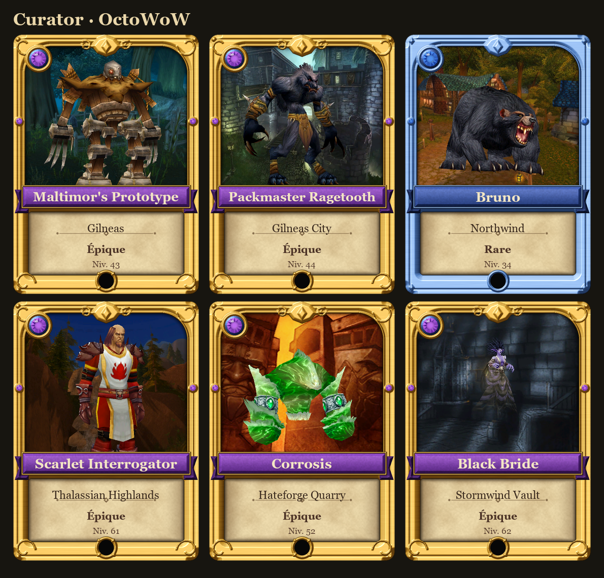

# Curator OctoWoW

Galerie expérimentale de cartes pour le client OctoWoW 1.12.1, inspirée de Curator 1.14.3 par Clément Hudson. Les cadres, gemmes et portraits repris de Curator conservent leurs droits d'origine. Les notices des données Questie-Octo figurent dans data/OctoQuestDatabase.

Télécharger Curator-OctoWoW-Galerie.zip depuis les Releases, extraire CuratorOctoGalerie dans Interface/AddOns, activer la galerie et lancer `/curatorgalerie`.

La galerie présente 259 cartes statiques sur six albums. Le catalogue de travail recense 903 cartes. L'affichage reste à valider en jeu sur le client 1.12.1. Le système de boosters, la sauvegarde de collection et les animations restent à intégrer.

Le dossier source contient la galerie et les scripts de production. Ils utilisent des données et médias locaux, avec les chemins de la machine de production à adapter. Les ZIP de la release contiennent les ressources prêtes à utiliser.
